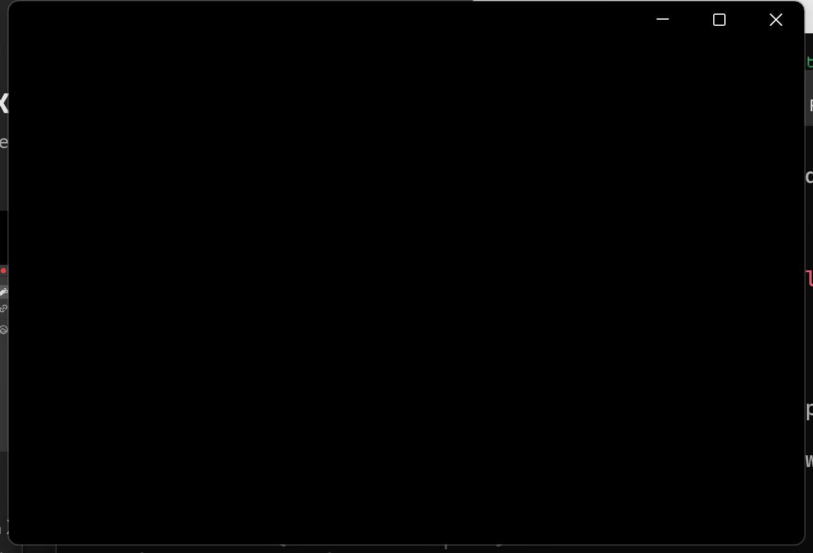

# FlipFPS

Turn your controller upside down — see your FPS and frametime, with a graph,
composited over **any OpenXR application**. Flip it back — it disappears.


FlipFPS is an **implicit OpenXR API layer**: it loads into every OpenXR app on
your machine automatically (no injection, no per-game setup, no dependency on
any specific engine or runtime) and draws nothing until you flip a controller.

## How it works

- The layer sits in the OpenXR call chain of the host application. At
  `xrEndFrame` it measures the interval between frame submissions — the app's
  real pacing against the runtime — and keeps a ring buffer of recent frames.
- It quietly appends its own action set (a single grip-pose action) to the
  app's suggested bindings, attached action sets, and per-frame sync. That
  gives it controller poses without touching the app's input.
- When a grip's up-vector points down (past ~120°) for a quarter second, the
  layer renders the HUD with a tiny built-in CPU rasterizer, uploads it to a
  runtime swapchain, and appends one `XrCompositionLayerQuad` floating above
  the flipped controller, billboarded toward your head. Flipping back hides it.
- `F10` toggles a head-locked fallback HUD (useful for apps that never attach
  action sets, or when you don't have controllers handy).

The HUD shows current FPS (color-coded against the runtime's refresh target),
average frametime in milliseconds, the target frametime, and a scrolling
per-frame graph with the target as a dashed line — green at target, amber for
minor misses, red for spikes.

## Install

Run the **FlipFPS Control Center** and press **Install layer**. That copies the
layer to `%LOCALAPPDATA%\FlipFPS` and registers it per-user (HKCU, no admin).
Every OpenXR app started afterwards has it.



The same window is where you tune everything, and **settings apply live** —
the layer re-reads them about once a second, so a game already running picks
up changes without restarting:

- **Gesture** — which controller, how far it must rotate, show/hide delays.
- **Placement & look** — panel size, distance off the controller, roll,
  opacity, theme, and how often the HUD repaints.
- **Readouts** — pick exactly which rows appear: FPS, frametime, target,
  on-target %, 1% low, and the frametime graph, plus system metrics (CPU and
  GPU usage, this app's own GPU share, VRAM, GPU clock/temperature, RAM).
- **Preview** — rendered by the layer's own HUD code, so what you see is what
  the headset shows, including live metric values.

System metrics come from the Control Center itself (PDH performance counters,
plus NVML on NVIDIA cards) and are handed to the layer through shared memory —
an API layer inside a game process cannot read them on its own. Leave the app
running to keep those rows updating; everything else works without it.

Disable temporarily for one game with `FLIPFPS_DISABLE=1`, or turn off
**Overlay enabled** to switch it off everywhere while leaving the layer
loaded. The PowerShell scripts under `scripts/` still work if you prefer
them, as does the fallback ImGui app (`-DFLIPFPS_BUILD_GUI=ON`) with
`--install` / `--uninstall` / `--status` for scripting.

The app is WinUI 3 (.NET 9) and drives `flipfps_core.dll`, which exports the
layer's own configuration, HUD renderer, installer and metrics collector — so
the settings, the preview and the headset all run the same code.

## Build

```powershell
cmake -S . -B build -A x64 -DOPENXR_SDK_PATH=<path-to-OpenXR-SDK>  # optional; fetched if omitted
cmake --build build --config Release
dotnet build app -c Release -p:Platform=x64        # the Control Center
```

Targets:

- `XrApiLayer_flipfps` — the layer DLL + manifest.
- `flipfps_core` — config, HUD renderer, installer and metrics behind a C ABI.
- `app/` — the WinUI 3 Control Center (needs the .NET 9 SDK).
- `flipfps_hudtest` — renders the HUD to a BMP for quick visual iteration,
  no headset required.
- `flipfps_testapp` — a minimal OpenXR app (D3D11 by default, `--d3d12` for
  D3D12) that clears the view, suggests bindings, attaches an action set, and
  runs the frame loop, for exercising the layer end-to-end — e.g. against
  [Meta XR Simulator] or SteamVR's headless null driver. It opts into Meta XR
  Operator's automation extension when present, so controller flips can be
  driven programmatically in tests.

For runtimes without drivable tracking, setting `FLIPFPS_TEST_POSE=1` makes
the layer accept a left-grip pose from shared memory
(`Local\FlipFPS_TestPose`, `float[8] = {active, px, py, pz, qx, qy, qz, qw}`)
in place of `xrLocateSpace` — `test/Drive-TestPose-Figure8.ps1` uses it to
sweep the flipped controller through a smooth figure-8 for verifying the
rigid HUD attachment.

[Meta XR Simulator]: https://developers.meta.com/horizon/documentation/native/xrsim-intro/

## Compatibility

| Graphics API | Status |
|---|---|
| D3D11 | ✅ |
| D3D12 | ✅ |
| Vulkan | planned |
| OpenGL | planned |

Tested against Meta XR Simulator (D3D11 test app, and a D3D12 UE5 title via
[UEVR]). Runtimes composite the HUD quad themselves, so anything that
implements core OpenXR quad layers works.

[UEVR]: https://github.com/praydog/UEVR

Notes and limits:

- FlipFPS measures the **frame interval** — the wall-clock cadence of the
  app's `xrEndFrame` submissions. That's delivered smoothness: at a locked
  90 fps it reads ~11.1 ms even if the GPU only needed 6, because vsync
  pacing quantizes delivery. Tools like fpsVR report CPU/GPU **workload
  times** instead; the numbers only coincide when the GPU is saturated.
  A layer cannot measure the app's GPU workload (it doesn't own the app's
  command queues), so that split is out of scope by design. The interval a
  frame after each HUD refresh is excluded from the stats so the overlay's
  own compositor cost never pollutes the graph.
- ON TGT shows what fraction of recent frames hit the target period —
  the fastest way to see "peak rate" vs "actually delivered rate" apart.
- Apps that never attach action sets get no flip gesture (nothing to bind
  against); use `F10` there.
- One quad is appended only when the app is under the runtime's
  `maxLayerCount`; if the app is at the limit, FlipFPS stays invisible rather
  than breaking the app's own layers.
- Logs at `%LOCALAPPDATA%\FlipFPS\flipfps.log` (event-rate only).

## Credits

- Bitmap font: [font8x8](https://github.com/dhepper/font8x8) by Daniel Hepper
  (public domain).

MIT license.
