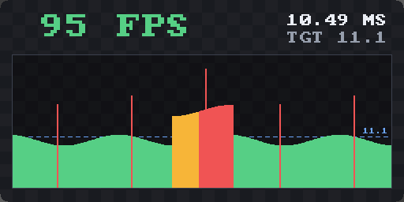

# FlipFPS

Turn your controller upside down — see your FPS and frametime, with a graph,
composited over **any OpenXR application**. Flip it back — it disappears.



FlipFPS is an **implicit OpenXR API layer**: it loads into every OpenXR app on
your machine automatically (no injection, no per-game setup, no dependency on
any specific engine or runtime) and draws nothing until you flip a controller.

## How it works

- The layer sits in the OpenXR call chain of the host application. At
  `xrEndFrame` it measures the interval between frame submissions — the app's
  real pacing against the runtime — and keeps a ring buffer of recent frames.
- It quietly appends its own action set (a single grip-pose action) to the
  app's suggested bindings, attached action sets, and per-frame sync. That
  gives it controller poses without touching the app's input.
- When a grip's up-vector points down (past ~120°) for a quarter second, the
  layer renders the HUD with a tiny built-in CPU rasterizer, uploads it to a
  runtime swapchain, and appends one `XrCompositionLayerQuad` floating above
  the flipped controller, billboarded toward your head. Flipping back hides it.
- `F10` toggles a head-locked fallback HUD (useful for apps that never attach
  action sets, or when you don't have controllers handy).

The HUD shows current FPS (color-coded against the runtime's refresh target),
average frametime in milliseconds, the target frametime, and a scrolling
per-frame graph with the target as a dashed line — green at target, amber for
minor misses, red for spikes.

## Install

Build (or grab a release), then:

```powershell
.\scripts\Install-Layer.ps1
```

This copies the layer to `%LOCALAPPDATA%\FlipFPS` and registers it per-user
(HKCU — no admin needed). Every OpenXR app started afterwards has it.

Remove with `.\scripts\Uninstall-Layer.ps1`. Disable temporarily by setting
the environment variable `FLIPFPS_DISABLE=1` for a given app.

## Build

```powershell
cmake -S . -B build -A x64 -DOPENXR_SDK_PATH=<path-to-OpenXR-SDK>  # optional; fetched if omitted
cmake --build build --config Release
```

Targets:

- `XrApiLayer_flipfps` — the layer DLL + manifest.
- `flipfps_hudtest` — renders the HUD to a BMP for quick visual iteration,
  no headset required.
- `flipfps_testapp` — a minimal OpenXR D3D11 app (clears the view, suggests
  bindings, attaches an action set, runs the frame loop) for exercising the
  layer end-to-end, e.g. against [Meta XR Simulator]. It opts into Meta XR
  Operator's automation extension when present, so controller flips can be
  driven programmatically in tests.

[Meta XR Simulator]: https://developers.meta.com/horizon/documentation/native/xrsim-intro/

## Compatibility

| Graphics API | Status |
|---|---|
| D3D11 | ✅ |
| D3D12 | ✅ |
| Vulkan | planned |
| OpenGL | planned |

Tested against Meta XR Simulator (D3D11 test app, and a D3D12 UE5 title via
[UEVR]). Runtimes composite the HUD quad themselves, so anything that
implements core OpenXR quad layers works.

[UEVR]: https://github.com/praydog/UEVR

Notes and limits:

- Frame stats measure the app's `xrEndFrame` cadence — the honest "how fast is
  this app actually submitting" number, which is what reprojection feeds on.
  GPU render time is not measured separately.
- Apps that never attach action sets get no flip gesture (nothing to bind
  against); use `F10` there.
- One quad is appended only when the app is under the runtime's
  `maxLayerCount`; if the app is at the limit, FlipFPS stays invisible rather
  than breaking the app's own layers.
- Logs at `%LOCALAPPDATA%\FlipFPS\flipfps.log` (event-rate only).

## Credits

- Bitmap font: [font8x8](https://github.com/dhepper/font8x8) by Daniel Hepper
  (public domain).

MIT license.
